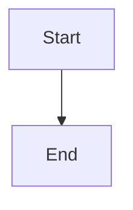

# Fixture document

Intro paragraph for the root section.

## Rendering

A relative image:


```js
const answer = 42;
console.log(answer);
```



See [the other note](other.md) for more.

## Second section

Some text in the second section.

### Nested

Nested body.
